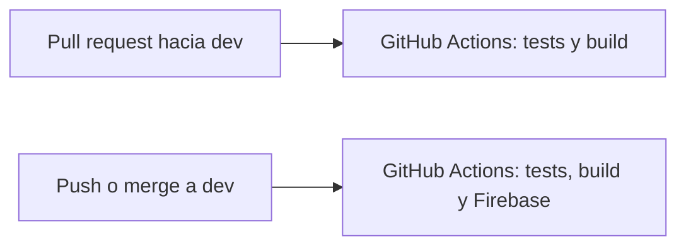

# Despliegue del frontend

Esta guía explica con qué se publica esta aplicación Angular y cómo dejarlo automático.

El flujo de este repositorio es:

1. Un pull request hacia la rama `dev` corre los tests y compila el proyecto.
2. Cuando ese código llega a la rama `dev` (un merge, o un push directo) se compila y se publica en Firebase Hosting.



Los archivos que arman eso están en el repo:

| Archivo | Para qué sirve |
| --- | --- |
| `.github/workflows/test-pr-dev.yml` | Tests cuando hay un pull request hacia `dev` |
| `.github/workflows/deploy-dev.yml` | Deploy a Firebase cuando llega código a `dev` |
| `firebase.json` | Le dice a Firebase qué carpeta publicar |
| `.firebaserc` | El id del proyecto Firebase |
| `package.json` → `test:ci` | Tests una sola vez, sin quedarse esperando cambios |

GitHub solo ejecuta esos workflows después de subirlos al remoto. Mientras estén solo en tu computador, no pasa nada en la nube.

---

## 1. Qué es YAML

YAML es un formato de texto para escribir configuración. Se lee casi como una lista con sangría. GitHub Actions, Firebase y muchos otros servicios lo usan porque es más corto que JSON y deja comentarios.

Un archivo de este proyecto, recortado:

```yaml
name: Tests en pull request a dev

on:
  pull_request:
    branches:
      - dev

jobs:
  test:
    runs-on: ubuntu-latest
    steps:
      - name: Instalar dependencias
        run: npm ci
```

Cómo se lee:

- `name` es un texto. El valor va después de los dos puntos.
- `on` dice cuándo se dispara el proceso. Aquí, cuando alguien abre o actualiza un pull request hacia `dev`.
- `branches` es una lista. Cada elemento empieza con `- `.
- `jobs` agrupa el trabajo. `test` es el nombre de ese trabajo.
- `steps` son los pasos, en orden. `run` es el comando que se ejecuta en la máquina.

Reglas que más se rompen:

- La sangría son espacios, no tabuladores. Dos espacios por nivel es lo habitual en estos workflows.
- Lo que está más a la derecha pertenece a lo que está arriba y más a la izquierda.
- `dev` y `main` son textos. Si un valor tiene `:` o caracteres raros, va entre comillas.
- `#` empieza un comentario. GitHub ignora el resto de esa línea.

JSON y YAML pueden describir los mismos datos. `firebase.json` está en JSON porque así lo pide la herramienta de Firebase. Los workflows están en YAML porque así lo pide GitHub Actions.

---

## 2. Qué es CI/CD

CI/CD son dos hábitos, a menudo juntos:

**CI (integración continua).** Cada vez que alguien propone código, una máquina limpia lo descarga, instala dependencias y lo prueba. Nadie depende de “en mi computador sí funciona”. Si los tests fallan, el pull request se ve en rojo y se puede corregir antes de mezclarlo.

**CD (entrega o despliegue continuo).** Si el código superó las pruebas y ya está en la rama que se considera publicable, esa misma máquina lo compila y lo sube al servidor. Aquí el servidor es Firebase Hosting y la rama publicable es `main`.

En este repo la división queda así:

| Momento | Qué corre | Qué no hace |
| --- | --- | --- |
| Pull request hacia `dev` | `npm run test:ci` y `npm run build` | No publica el sitio |
| Push a `main` (incluye un merge) | Tests, build y deploy a Firebase | No corre por un push a `dev` |

El build del pull request existe para descubrir un error de compilación antes del merge. El deploy de `main` vuelve a correr los tests: si fallan, Firebase no se toca.

---

## 3. Qué es GitHub Actions

GitHub Actions es el servicio de GitHub que ejecuta esos archivos YAML. El archivo se llama workflow y vive en `.github/workflows/`.

Piezas:

- **Evento (`on`).** Lo que despierta el workflow: un pull request, un push, un horario, un clic manual.
- **Job.** Un trabajo que corre en una máquina virtual nueva. Aquí se usa `ubuntu-latest`.
- **Step.** Un paso del job. Puede ser un comando (`run: npm ci`) o una acción reutilizable (`uses: actions/checkout@v4`).
- **Action.** Un paso empaquetado por GitHub o por otra persona. `actions/checkout` baja el código del repo. `actions/setup-node` instala Node.js. `FirebaseExtended/action-hosting-deploy` publica en Firebase Hosting.
- **Runner.** La máquina que ejecuta el job. Se crea vacía, corre los pasos y se destruye. Por eso hay que instalar Node y las dependencias en cada ejecución.
- **Secret.** Un valor cifrado en GitHub (Settings → Secrets and variables → Actions). El workflow lo usa como `${{ secrets.FIREBASE_SERVICE_ACCOUNT }}`. El log no muestra el contenido. No se escribe en el YAML.
- **Check.** El resultado verde o rojo que aparece en el pull request y en la pestaña Actions del repositorio.

`npm ci` instala exactamente lo que está en `package-lock.json`. En CI se usa en lugar de `npm install` para que la máquina de GitHub y tu computador usen las mismas versiones.

`npm run test:ci` ejecuta `ng test --watch=false`. Sin `--watch=false`, el test puede quedarse abierto esperando que cambies un archivo, y el workflow no terminaría. En local, `npm test` sigue en modo vigilancia.

---

## 4. Qué es Firebase

Firebase es una plataforma de Google para backends y alojamiento. Este frontend solo usa **Firebase Hosting**: un sitio estático con HTTPS.

Angular, al compilarse con `npm run build`, deja de ser TypeScript y pasa a ser HTML, CSS y JavaScript en:

```text
dist/programacion-software-frontend/browser
```

Esa carpeta es lo que Hosting publica. El navegador del usuario no necesita Node ni Angular CLI.

`firebase.json` apunta a esa carpeta. El bloque `rewrites` manda cualquier ruta (`/usuarios`, `/tarjetas`, etc.) a `index.html`. Angular es una sola página: el servidor no tiene un archivo por cada ruta, y sin esa regla un refresco en `/tarjetas` devolvería 404.

`.firebaserc` guarda el id del proyecto. Hoy dice `TU_PROJECT_ID`. Hay que cambiarlo por el id real antes del primer deploy. El workflow de `main` se detiene a propósito si ese texto sigue ahí.

Al publicar, el sitio queda en dos direcciones:

- `https://TU_PROJECT_ID.web.app`
- `https://TU_PROJECT_ID.firebaseapp.com`

Sustituye `TU_PROJECT_ID` por el id real. Las dos direcciones sirven el mismo sitio.

---

## 5. Antes de desplegar: la URL de la API

El frontend llama al backend con la dirección de `src/environments/environment.ts`. En desarrollo es `http://127.0.0.1:8000`, tu computador.

Esa dirección no le sirve a una persona que abre el sitio en Firebase: `127.0.0.1` sería el computador de esa persona, no el servidor. Antes de publicar hay que poner ahí la URL pública del backend, volver a compilar y desplegar.

Si el backend solo acepta peticiones desde ciertos orígenes, hay que permitir el dominio de Firebase (`https://TU_PROJECT_ID.web.app`) en su CORS. Si no, el navegador bloquea las llamadas aunque Hosting haya publicado bien.

---

## 6. Paso a paso: Firebase y un deploy manual

Haz esto una vez, desde la raíz de este repositorio (la carpeta donde está `package.json`).

### 6.1. Crear el proyecto

1. Entra a [Firebase console](https://console.firebase.google.com/) con una cuenta de Google.
2. Clic en **Agregar proyecto** (o **Create a project**).
3. Pon un nombre. Firebase propone un **id de proyecto**. Ese id es el que va en `.firebaserc`. Se puede editar antes de crear el proyecto. Anótalo: no lleva espacios y después no se cambia fácil.
4. Google Analytics es opcional para Hosting. Puedes desactivarlo.
5. Cuando el proyecto exista, en el menú entra a **Build → Hosting** (o **Compilación → Hosting**) y pulsa **Comenzar**. Si pide el asistente de la CLI, puedes cerrarlo: la configuración de Hosting ya está en `firebase.json`.

### 6.2. Instalar la CLI e iniciar sesión

Necesitas Node.js. En una terminal:

```bash
npm install -g firebase-tools
firebase login
```

`firebase login` abre el navegador para entrar con la misma cuenta de Google del proyecto. Eso autoriza tu computador. No es el secreto que usa GitHub.

### 6.3. Decirle al repo cuál es tu proyecto

Abre `.firebaserc` y cambia `TU_PROJECT_ID` por el id del paso 6.1:

```json
{
  "projects": {
    "default": "banco-itm-2026"
  }
}
```

`banco-itm-2026` es un ejemplo. Tiene que ser el id exacto del proyecto, el que se ve en Configuración del proyecto en la consola.

Comprueba la conexión:

```bash
firebase projects:list
```

Tu proyecto debe salir en la lista. Si la CLI pregunta por el proyecto al desplegar, elige el mismo id.

### 6.4. Compilar y publicar a mano

```bash
npm ci
npm run build
firebase deploy --only hosting
```

`npm run build` genera `dist/programacion-software-frontend/browser`. `firebase deploy --only hosting` sube solo esa carpeta. No sube `node_modules` ni el código fuente de Angular.

Al terminar, la CLI imprime la URL `https://<id>.web.app`. Ábrela. Si ves la aplicación, Hosting quedó bien.

Para repetir un deploy manual después de un cambio: otra vez `npm run build` y `firebase deploy --only hosting`.

---

## 7. Paso a paso: el deploy automático en GitHub

El workflow `.github/workflows/deploy-main.yml` publica solo si existen dos cosas: el id real en `.firebaserc` y un secreto llamado `FIREBASE_SERVICE_ACCOUNT`.

La cuenta de servicio es un usuario robot del proyecto Firebase. GitHub la usa para desplegar sin tu contraseña de Google. El archivo JSON de esa cuenta es una llave: no se commitea, no se pega en el chat y no se deja en el escritorio del repo. `.gitignore` ignora esos JSON por si se descargan dentro de la carpeta.

### 7.1. Crear la cuenta de servicio

1. Abre [las cuentas de servicio de Google Cloud](https://console.cloud.google.com/iam-admin/serviceaccounts) y, arriba, elige el mismo proyecto de Firebase.
2. **Crear cuenta de servicio**. Nombre sugerido: `github-actions-hosting`.
3. En roles, asigna estos tres:
   - **Firebase Hosting Admin** (`roles/firebasehosting.admin`): permiso para publicar el sitio.
   - **API Keys Viewer** (`roles/serviceusage.apiKeysViewer`): la CLI de Firebase lo pide al desplegar.
   - **Firebase Authentication Admin** (`roles/firebaseauth.admin`): la acción de GitHub lo usa al registrar el dominio del sitio.
4. Termina la creación. Entra a esa cuenta → pestaña **Claves** → **Agregar clave** → **Crear clave nueva** → JSON.
5. Se descarga un archivo `.json`. Ábrelo con un editor de texto. Vas a copiar el contenido completo, desde `{` hasta `}`.

### 7.2. Guardar la llave como secreto de GitHub

1. En GitHub abre este repositorio: `alejandrosalgar/Programacion-de-software-2026-2---frontend`.
2. **Settings → Secrets and variables → Actions → New repository secret**.
3. Name: `FIREBASE_SERVICE_ACCOUNT`. Tiene que coincidir con el nombre del workflow.
4. Secret: pega el JSON completo. Una sola línea o varias: da igual, pero no recortes campos.
5. Guarda. Después de guardado, GitHub no deja ver el valor otra vez. Si lo pierdes, generas otra clave y actualizas el secreto.
6. Borra el JSON descargado o muévelo fuera del repositorio.

### 7.3. Subir los workflows

Los archivos de `.github/workflows/` tienen que estar en GitHub, en la rama que dispara el evento.

- El test del pull request corre cuando el workflow ya existe en la rama base (`dev`) o llega en el propio pull request.
- El deploy corre cuando hay un push a `main` y ese commit ya contiene `deploy-main.yml`, `.firebaserc` con el id real y `firebase.json`.

Haz el commit de estos archivos, súbelos y mezcla a `main` la primera vez. A partir de ahí, cada llegada a `main` intenta publicar.

### 7.4. Ver el resultado

1. En el repositorio, pestaña **Actions**.
2. El workflow **Tests en pull request a dev** aparece al abrir un pull request cuya rama destino es `dev`.
3. El workflow **Deploy a Firebase al llegar a main** aparece al mezclar o empujar a `main`.
4. Si el deploy termina en verde, la URL del sitio es la del paso 6.4. El log del paso “Desplegar Firebase Hosting” también la imprime.

---

## 8. Qué hace cada workflow

### Pull request hacia `dev`

Archivo: `.github/workflows/test-pr-dev.yml`.

1. Descarga el código del pull request.
2. Instala Node.js 22 (Angular 21 lo necesita).
3. `npm ci`.
4. `npm run test:ci`.
5. `npm run build`, la misma compilación de producción que después se publica.

No usa secretos de Firebase. Un pull request de otra persona no recibe la llave.

### Llegada a `main`

Archivo: `.github/workflows/deploy-main.yml`.

Repite los pasos anteriores y después:

1. Lee `.firebaserc`. Si todavía dice `TU_PROJECT_ID`, falla con un mensaje y no llama a Firebase.
2. Llama a `FirebaseExtended/action-hosting-deploy@v0` con `channelId: live`. `live` es el sitio público, no un preview.
3. `entryPoint: .` indica que `firebase.json` está en la raíz del repo.

`concurrency` evita dos deploys a producción pisándose: si ya hay uno en curso, el siguiente espera.

---

## 9. Problemas frecuentes

| Síntoma | Qué revisar |
| --- | --- |
| El pull request no muestra ningún check | El workflow no está en GitHub, o el pull request no apunta a `dev`. |
| El deploy falla con `TU_PROJECT_ID` | Falta cambiar `.firebaserc` y subir ese cambio a `main`. |
| `Permission denied` o error de credenciales | El secreto `FIREBASE_SERVICE_ACCOUNT` no existe, está incompleto, o la cuenta no tiene los roles de la sección 7.1. |
| El sitio abre y las rutas internas dan 404 al refrescar | `firebase.json` perdió el `rewrite` hacia `/index.html`. |
| El sitio abre y no carga datos | `environment.ts` sigue en `http://127.0.0.1:8000`, o el backend no permite el dominio de Firebase en CORS. |
| `npm ci` falla | `package-lock.json` no está commiteado o no coincide con `package.json`. |
| Quieres volver a la versión anterior del sitio | En Firebase console → Hosting hay un historial de releases. Desde ahí se puede hacer rollback. |

La llave JSON y `firebase login` son cosas distintas. La primera la usa GitHub. La segunda la usas tú en la terminal para `firebase deploy`.
