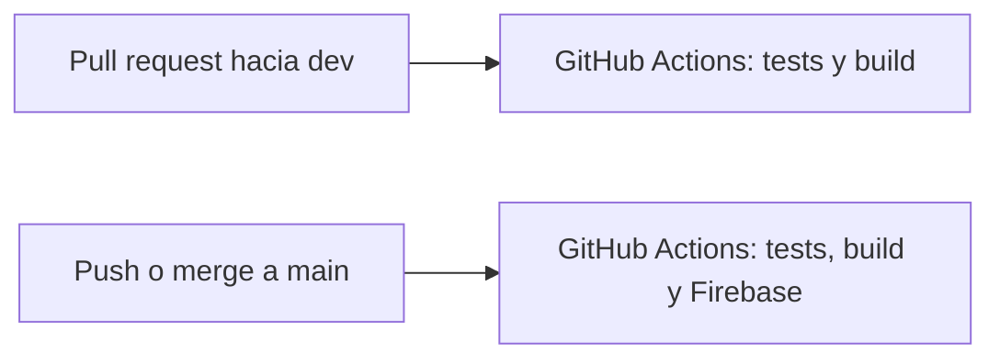

# Despliegue del frontend

Esta guía explica con qué se publica esta aplicación Angular y cómo dejarlo automático.

El flujo de este repositorio es:

1. Un pull request hacia la rama `dev` corre los tests y compila el proyecto.
2. Cuando ese código llega a la rama `main` (un merge, o un push directo) se compila y se publica en Firebase Hosting.



Los archivos que arman eso están en el repo:

| Archivo | Para qué sirve |
| --- | --- |
| `.github/workflows/test-pr-dev.yml` | Tests cuando hay un pull request hacia `dev` |
| `.github/workflows/deploy-dev.yml` | Deploy a Firebase cuando llega código a `main` |
| `firebase.json` | Le dice a Firebase qué carpeta publicar. Lo genera `firebase init hosting` |
| `.firebaserc` | El id del proyecto Firebase. Lo escribe `firebase init hosting` al elegir el proyecto |
| `package.json` → `test:ci` | Tests una sola vez, sin quedarse esperando cambios |

GitHub solo ejecuta esos workflows después de subirlos al remoto. Mientras estén solo en tu computador, no pasa nada en la nube.

---

## 1. Qué es YAML

YAML es un formato de texto para escribir configuración. Se lee casi como una lista con sangría. GitHub Actions, Firebase y muchos otros servicios lo usan porque es más corto que JSON y deja comentarios.

Un archivo de este proyecto, recortado:

```yaml
name: Tests en pull request a dev

on:
  pull_request:
    branches:
      - dev

jobs:
  test:
    runs-on: ubuntu-latest
    steps:
      - name: Instalar dependencias
        run: npm ci
```

Cómo se lee:

- `name` es un texto. El valor va después de los dos puntos.
- `on` dice cuándo se dispara el proceso. Aquí, cuando alguien abre o actualiza un pull request hacia `dev`.
- `branches` es una lista. Cada elemento empieza con `- `.
- `jobs` agrupa el trabajo. `test` es el nombre de ese trabajo.
- `steps` son los pasos, en orden. `run` es el comando que se ejecuta en la máquina.

Reglas que más se rompen:

- La sangría son espacios, no tabuladores. Dos espacios por nivel es lo habitual en estos workflows.
- Lo que está más a la derecha pertenece a lo que está arriba y más a la izquierda.
- `dev` y `main` son textos. Si un valor tiene `:` o caracteres raros, va entre comillas.
- `#` empieza un comentario. GitHub ignora el resto de esa línea.

JSON y YAML pueden describir los mismos datos. `firebase.json` está en JSON porque así lo pide la herramienta de Firebase. Los workflows están en YAML porque así lo pide GitHub Actions.

---

## 2. Qué es CI/CD

CI/CD son dos hábitos, a menudo juntos:

**CI (integración continua).** Cada vez que alguien propone código, una máquina limpia lo descarga, instala dependencias y lo prueba. Nadie depende de “en mi computador sí funciona”. Si los tests fallan, el pull request se ve en rojo y se puede corregir antes de mezclarlo.

**CD (entrega o despliegue continuo).** Si el código superó las pruebas y ya está en la rama que se considera publicable, esa misma máquina lo compila y lo sube al servidor. Aquí el servidor es Firebase Hosting y la rama publicable es `main`.

En este repo la división queda así:

| Momento | Qué corre | Qué no hace |
| --- | --- | --- |
| Pull request hacia `dev` | `npm run test:ci` y `npm run build` | No publica el sitio |
| Push a `main` (incluye un merge) | Tests, build y deploy a Firebase | No corre por un push a `dev` |

El build del pull request existe para descubrir un error de compilación antes del merge. El deploy de `main` vuelve a correr los tests: si fallan, Firebase no se toca.

---

## 3. Qué es GitHub Actions

GitHub Actions es el servicio de GitHub que ejecuta esos archivos YAML. El archivo se llama workflow y vive en `.github/workflows/`.

Piezas:

- **Evento (`on`).** Lo que despierta el workflow: un pull request, un push, un horario, un clic manual.
- **Job.** Un trabajo que corre en una máquina virtual nueva. Aquí se usa `ubuntu-latest`.
- **Step.** Un paso del job. Puede ser un comando (`run: npm ci`) o una acción reutilizable (`uses: actions/checkout@v4`).
- **Action.** Un paso empaquetado por GitHub o por otra persona. `actions/checkout` baja el código del repo. `actions/setup-node` instala Node.js. `FirebaseExtended/action-hosting-deploy` publica en Firebase Hosting.
- **Runner.** La máquina que ejecuta el job. Se crea vacía, corre los pasos y se destruye. Por eso hay que instalar Node y las dependencias en cada ejecución.
- **Secret.** Un valor cifrado en GitHub (Settings → Secrets and variables → Actions). El workflow lo usa como `${{ secrets.FIREBASE_SERVICE_ACCOUNT }}`. El log no muestra el contenido. No se escribe en el YAML.
- **Check.** El resultado verde o rojo que aparece en el pull request y en la pestaña Actions del repositorio.

`npm ci` instala exactamente lo que está en `package-lock.json`. En CI se usa en lugar de `npm install` para que la máquina de GitHub y tu computador usen las mismas versiones.

`npm run test:ci` ejecuta `ng test --watch=false`. Sin `--watch=false`, el test puede quedarse abierto esperando que cambies un archivo, y el workflow no terminaría. En local, `npm test` sigue en modo vigilancia.

---

## 4. Qué es Firebase

Firebase es una plataforma de Google para backends y alojamiento. Este frontend solo usa **Firebase Hosting**: un sitio estático con HTTPS.

Angular, al compilarse con `npm run build`, deja de ser TypeScript y pasa a ser HTML, CSS y JavaScript en:

```text
dist/programacion-software-frontend/browser
```

Esa carpeta es lo que Hosting publica. El navegador del usuario no necesita Node ni Angular CLI.

`firebase.json` apunta a esa carpeta. El bloque `rewrites` manda cualquier ruta (`/usuarios`, `/tarjetas`, etc.) a `index.html`. Angular es una sola página: el servidor no tiene un archivo por cada ruta, y sin esa regla un refresco en `/tarjetas` devolvería 404.

Esos dos archivos no se abren ni se editan. `firebase init hosting` pregunta qué proyecto usar y, con esa respuesta, escribe `.firebaserc` (el id) y `firebase.json` (la carpeta del build y el rewrite). El workflow de `main` se detiene si el id guardado sigue siendo el texto `TU_PROJECT_ID`.

Al publicar, el sitio queda en dos direcciones:

- `https://TU_PROJECT_ID.web.app`
- `https://TU_PROJECT_ID.firebaseapp.com`

Sustituye `TU_PROJECT_ID` por el id real. Las dos direcciones sirven el mismo sitio.

---

## 5. Antes de desplegar: la URL de la API

El frontend llama al backend con la dirección de `src/environments/environment.ts`. En desarrollo es `http://127.0.0.1:8000`, tu computador.

Esa dirección no le sirve a una persona que abre el sitio en Firebase: `127.0.0.1` sería el computador de esa persona, no el servidor. Antes de publicar hay que poner ahí la URL pública del backend, volver a compilar y desplegar.

Si el backend solo acepta peticiones desde ciertos orígenes, hay que permitir el dominio de Firebase (`https://TU_PROJECT_ID.web.app`) en su CORS. Si no, el navegador bloquea las llamadas aunque Hosting haya publicado bien.

---

## 6. Paso a paso: Firebase y un deploy manual

Todo sale de la CLI de Firebase: el proyecto, el sitio de Hosting y los dos archivos de configuración. No hace falta la consola para crear nada, ni escribir `firebase.json` o `.firebaserc` en un editor.

Hazlo una vez, desde la raíz de este repositorio (la carpeta donde está `package.json`).

### 6.1. Instalar la CLI e iniciar sesión

Necesitas Node.js. En una terminal:

```bash
npm install -g firebase-tools
firebase login
```

`firebase login` abre el navegador para entrar con la cuenta de Google que será dueña del proyecto. Eso autoriza tu computador. Si ya entraste, compruébalo con `firebase projects:list`.

### 6.2. Crear el proyecto

El id del proyecto es el que va en las URLs (`https://TU_ID.web.app`). Reglas: de 6 a 30 caracteres, empieza por una letra, solo minúsculas, números y guiones, único en todo Firebase. Después no se cambia fácil.

```bash
firebase projects:create TU_ID --display-name "Programacion de software"
```

`banco-itm-2026` es un ejemplo de `TU_ID`. Si la CLI dice que ese id ya existe, elige otro y vuelve a correr el comando.

Si el proyecto ya estaba creado en esa cuenta, no lo crees otra vez. Míralo en la lista:

```bash
firebase projects:list
```

### 6.3. Inicializar Hosting

`firebase projects:create` crea el proyecto en la cuenta de Google. El archivo local lo escribe el siguiente comando: pregunta cuál proyecto usar y, al elegirlo, crea `.firebaserc` y `firebase.json`. Si el proyecto todavía no tiene sitio de Hosting, también lo crea.

```bash
firebase init hosting
```

No abras `.firebaserc` para cambiar un id. La elección en esta pregunta es lo que queda guardado.

Responde así cuando pregunte:

| Pregunta | Respuesta |
| --- | --- |
| ¿Qué proyecto de Firebase? | El mismo `TU_ID` |
| A Firebase Hosting site is required. Would you like to create one now? | **Yes** |
| Id del sitio | Enter, para aceptar el que propone (normalmente el id del proyecto) |
| ¿Usar App Hosting, o seguir si detecta Angular con servidor? | **No** a App Hosting. Esta aplicación es un sitio estático. Si pregunta si continuar con Hosting, **Yes** |
| What do you want to use as your public directory? | `dist/programacion-software-frontend/browser` |
| Configure as a single-page app (rewrite all urls to /index.html)? | **Yes** |
| Set up automatic builds and deploys with GitHub? | **No**. El secreto de GitHub va en la sección 7 |
| File index.html already exists. Overwrite? | **No** |

**Yes** en la aplicación de una sola página es el rewrite: cualquier ruta (`/usuarios`, `/tarjetas`) va a `index.html`. Sin eso, refrescar `/tarjetas` devuelve 404.

Al terminar, `.firebaserc` queda con el id que elegiste. Con el ejemplo `banco-itm-2026` se ve así:

```json
{
  "projects": {
    "default": "banco-itm-2026"
  }
}
```

`firebase.json` queda así. Los dos sirven para comprobar el resultado; no se copian a mano:

```json
{
  "hosting": {
    "public": "dist/programacion-software-frontend/browser",
    "ignore": [
      "firebase.json",
      "**/.*",
      "**/node_modules/**"
    ],
    "rewrites": [
      {
        "source": "**",
        "destination": "/index.html"
      }
    ]
  }
}
```

Si la CLI crea un `index.html` de ejemplo dentro de `dist/`, se ignora: `/dist` está en `.gitignore` y el siguiente `npm run build` reemplaza esa carpeta. `firebase.json` y `.firebaserc` sí se commitean. El workflow de `main` lee ese id y se detiene si sigue siendo el texto `TU_PROJECT_ID`.

### 6.4. Compilar y publicar

```bash
npm ci
npm run build
firebase deploy --only hosting
```

`npm run build` genera `dist/programacion-software-frontend/browser`. `firebase deploy --only hosting` sube solo esa carpeta. No sube `node_modules` ni el código fuente de Angular. El primer deploy deja Hosting activo; no hay un paso aparte en la consola.

Al terminar, la CLI imprime `https://TU_ID.web.app`. Ábrela. La misma publicación también queda en `https://TU_ID.firebaseapp.com`.

Para repetir un deploy manual después de un cambio: otra vez `npm run build` y `firebase deploy --only hosting`.

---

## 7. Paso a paso: el deploy automático en GitHub

El workflow `.github/workflows/deploy-dev.yml` publica al llegar código a `main`. El archivo se llama `deploy-dev.yml` y el disparador es la rama `main`. Publica solo si existen dos cosas: el id real en `.firebaserc` y el secreto de GitHub con la llave de una cuenta de servicio.

La cuenta de servicio es un usuario robot del proyecto Firebase. GitHub la usa para desplegar sin tu contraseña de Google. La llave es un JSON. La CLI la crea y la sube cifrada al repositorio. No se descarga, no se pega en Settings y no se commitea. `.gitignore` ignora esos JSON por si alguno cae dentro de la carpeta.

Hace falta permiso de administrador en `alejandrosalgar/Programacion-de-software-2026-2---frontend`, y que la sección 6 ya haya dejado `firebase.json` y `.firebaserc` en la raíz.

### 7.1. Crear la cuenta y subir el secreto

```bash
firebase init hosting:github
```

El comando abre el navegador para autorizar a la CLI en GitHub. Responde así:

| Pregunta | Respuesta |
| --- | --- |
| For which GitHub repository would you like to set up a GitHub workflow? | `alejandrosalgar/Programacion-de-software-2026-2---frontend` |
| Set up the workflow to run a build script before every deploy? | **No** |
| Set up automatic deployment to your site's live channel when a PR is merged? | **No** |

Las dos van en **No** porque este repo ya tiene sus workflows. Los tests del pull request están en `test-pr-dev.yml`. El deploy a producción está en `deploy-dev.yml`, y ese corre los tests antes de publicar. Si aceptas el canal live, la CLI escribe otro workflow y `main` se publicaría dos veces.

La CLI igual crea `.github/workflows/firebase-hosting-pull-request.yml`. Ese archivo publicaría un preview en cada pull request. Bórralo y no lo subas. El secreto queda en GitHub aunque borres el archivo.

Al terminar, la CLI imprime el nombre del secreto, con esta forma:

```text
Uploaded service account JSON to GitHub as secret FIREBASE_SERVICE_ACCOUNT_BANCO_ITM_2026
```

El nombre sale del id del proyecto: los guiones pasan a guion bajo y todo queda en mayúsculas. El id `banco-itm-2026` produce `FIREBASE_SERVICE_ACCOUNT_BANCO_ITM_2026`. Anota el nombre que imprime tu comando, no el del ejemplo.

En `.github/workflows/deploy-dev.yml`, la línea `firebaseServiceAccount` tiene que usar ese nombre:

```yaml
firebaseServiceAccount: ${{ secrets.FIREBASE_SERVICE_ACCOUNT_BANCO_ITM_2026 }}
```

GitHub no vuelve a mostrar el valor. Si hay que repetir la llave, corre otra vez `firebase init hosting:github`.

### 7.2. Subir lo que la CLI generó

Commitea y sube a `main`:

- `.firebaserc`
- `firebase.json`
- el cambio del nombre del secreto en `deploy-dev.yml`

Los workflows de `.github/workflows/` tienen que estar en GitHub, en la rama que dispara el evento.

- El test del pull request corre cuando el workflow ya existe en la rama base (`dev`) o llega en el propio pull request.
- El deploy corre cuando hay un push a `main` y ese commit ya contiene `deploy-dev.yml`, `.firebaserc` con el id real y `firebase.json`.

A partir de ese push, cada llegada a `main` intenta publicar.

### 7.3. Ver el resultado

1. En el repositorio, pestaña **Actions**.
2. El workflow **Tests en pull request a dev** aparece al abrir un pull request cuya rama destino es `dev`.
3. El workflow **Deploy a Firebase al llegar a main** aparece al mezclar o empujar a `main`.
4. Si el deploy termina en verde, la URL del sitio es la del paso 6.4. El log del paso “Desplegar Firebase Hosting” también la imprime.

---

## 8. Qué hace cada workflow

### Pull request hacia `dev`

Archivo: `.github/workflows/test-pr-dev.yml`.

1. Descarga el código del pull request.
2. Instala Node.js 22 (Angular 21 lo necesita).
3. `npm ci`.
4. `npm run test:ci`.
5. `npm run build`, la misma compilación de producción que después se publica.

No usa secretos de Firebase. Un pull request de otra persona no recibe la llave.

### Llegada a `main`

Archivo: `.github/workflows/deploy-dev.yml`. Se dispara con un push a `main`.

Repite los pasos anteriores y después:

1. Lee `.firebaserc`. Si todavía dice `TU_PROJECT_ID`, falla con un mensaje y no llama a Firebase.
2. Llama a `FirebaseExtended/action-hosting-deploy@v0` con `channelId: live` y el secreto que imprimió `firebase init hosting:github`. `live` es el sitio público, no un preview.
3. `entryPoint: .` indica que `firebase.json` está en la raíz del repo.

`concurrency` evita dos deploys a producción pisándose: si ya hay uno en curso, el siguiente espera.

---

## 9. Problemas frecuentes

| Síntoma | Qué revisar |
| --- | --- |
| El pull request no muestra ningún check | El workflow no está en GitHub, o el pull request no apunta a `dev`. |
| El deploy falla con `TU_PROJECT_ID` | En `firebase init hosting` no se eligió el proyecto real, o `.firebaserc` no está en `main`. |
| `Permission denied` o error de credenciales | `firebase init hosting:github` no terminó, o el nombre en `firebaseServiceAccount` no es el que imprimió la CLI. |
| Un pull request publica un preview | Quedó commiteado `firebase-hosting-pull-request.yml`. Bórralo. El secreto de GitHub no depende de ese archivo. |
| El sitio abre y las rutas internas dan 404 al refrescar | En `firebase init hosting` hay que responder **Yes** a single-page app. `firebase.json` tiene que tener el `rewrite` hacia `/index.html`. |
| El sitio abre y no carga datos | `environment.ts` sigue en `http://127.0.0.1:8000`, o el backend no permite el dominio de Firebase en CORS. |
| `npm ci` falla | `package-lock.json` no está commiteado o no coincide con `package.json`. |
| Quieres volver a la versión anterior del sitio | En Firebase console → Hosting hay un historial de releases. Desde ahí se puede hacer rollback. |

`firebase login` autoriza tu computador para `firebase deploy`. La llave que usa GitHub la crea y la sube `firebase init hosting:github`. Son dos credenciales distintas.
